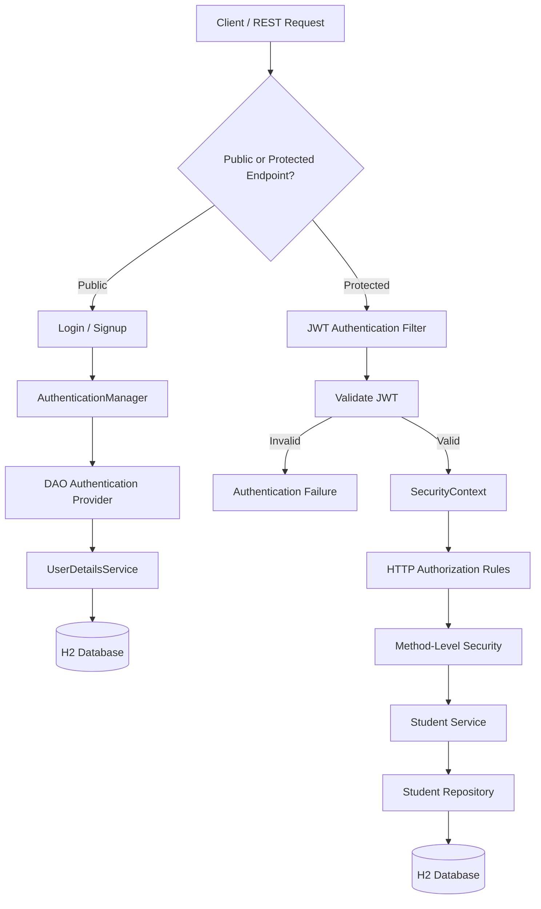

# 🔐 Spring Authentication & Authorization

<p align="center">
  <strong>A Spring Boot project demonstrating authentication, JWT-based security, role-based access control, and method-level authorization.</strong>
</p>

<p align="center">
  
  
  
  
  
  
</p>

---

## 📌 Overview

**Spring Authentication & Authorization** is a hands-on project that explores how authentication and authorization are implemented using Spring Security. It progresses from database-backed username/password authentication to stateless JWT authentication, role-based access control (RBAC), and method-level security.

The application includes a Student Management REST API backed by Spring Data JPA and an H2 in-memory database, demonstrating how security rules can be enforced at both the HTTP request and business-service layers.

## ✨ Key Features

- 🔑 **Database-backed authentication** — Authenticate users using credentials stored with JPA and verify passwords using BCrypt.
- 🎟️ **JWT authentication** — Authenticate through `POST /login` and access protected APIs using signed Bearer tokens.
- 🛡️ **Role-based access control (RBAC)** — Distinguish between `ADMIN` and `USER` permissions.
- ⚙️ **Custom security configuration** — Configure a `SecurityFilterChain`, `UserDetailsService`, DAO authentication provider, and custom JWT filter.
- 🔒 **Method-level authorization** — Apply `@PreAuthorize` and `@PostAuthorize` to enforce access rules at the service layer.
- 👥 **Role and authority mapping** — Map roles to granular `READ`, `WRITE`, `UPDATE`, and `DELETE` authorities.
- 🎓 **Student CRUD API** — Create, retrieve, update, and delete student records with authorization checks.
- 🗄️ **JPA and H2 integration** — Persist entities in an in-memory relational database during application execution.
- 📝 **Controlled user registration** — Restrict account creation and role assignment according to the configured authorization rules.

## 🧰 Technology Stack

| Technology | Purpose |
|---|---|
| Java 21 | Programming language |
| Spring Boot | Application framework and configuration |
| Spring Security | Authentication and authorization |
| Spring Data JPA | Database persistence and repository abstraction |
| Hibernate | ORM and entity-to-table mapping |
| H2 Database | Lightweight in-memory relational database |
| JJWT | JWT generation, parsing, and validation |
| BCrypt | Password hashing |
| Maven | Dependency management and build automation |
| REST API | HTTP-based application interface |

## 🏗️ Security Architecture

The application uses a layered security architecture:



### 🔄 Authentication Flow

1. The client submits credentials to `POST /login`.
2. Spring Security authenticates the credentials against the database-backed user details.
3. BCrypt is used to verify the stored password hash.
4. Upon successful authentication, the application generates a signed JWT.
5. The client includes the token in subsequent requests using the `Authorization: Bearer <token>` header.
6. The custom JWT filter validates the token and establishes the authenticated principal in the `SecurityContext`.
7. Request-level and method-level authorization rules determine whether the operation is permitted.

**Token expiration:** JWTs expire after one hour.

## 👤 Roles & Permissions

The application defines two roles with different access levels.

| Capability | `ADMIN` | `USER` |
|---|:---:|:---:|
| Read all student records | ✅ | ❌ |
| Read records marked as created by `USER` | ✅ | ✅ |
| Create student records | ✅ | ✅ |
| Update student records | ✅ | ❌ |
| Delete student records | ✅ | ❌ |
| Create user accounts through signup | ✅ | ❌ |
| Assign the `ADMIN` role during signup | ✅ | ❌ |

### 🔑 Authority Mapping

| Role | Granted authorities |
|---|---|
| `ADMIN` | `READ`, `WRITE`, `UPDATE`, `DELETE` |
| `USER` | `READ` |

Authorities represent granular permissions, while roles group those permissions. The application uses role checks and authority checks according to the operation being protected.

### 🛡️ Authorization Mechanisms

- **`SecurityFilterChain`** — Defines which HTTP requests are public and which require authentication or specific permissions.
- **`@EnableMethodSecurity`** — Enables method-level authorization.
- **`@PreAuthorize`** — Checks access before executing a method.
- **`@PostAuthorize`** — Checks access after method execution, allowing authorization decisions based on the returned object.
- **Creator-based filtering** — Administrators can retrieve all student records, while users are restricted to records categorized as created by `USER`.

> **Note:** Student ownership is categorized by creator role, not by individual account. Consequently, the current implementation does not provide per-user record ownership.

## 🌐 REST API Reference

The following endpoints describe the intended application behavior. Protected endpoints require a valid JWT unless explicitly marked public.

| Method | Endpoint | Access | Description |
|---|---|---|---|
| `POST` | `/login` | Public | Authenticate credentials and obtain a JWT |
| `POST` | `/signup` | `ADMIN` | Create a user account with an authorized role |
| `GET` | `/hello` | `ADMIN`, `USER` | Access the authenticated greeting endpoint |
| `GET` | `/students` | `READ` | Retrieve student records allowed by the caller's role |
| `GET` | `/students/{id}` | `READ` | Retrieve an individual student subject to authorization |
| `POST` | `/students` | `ADMIN`, `USER` | Create a student record |
| `PUT` | `/students/{id}` | `UPDATE` | Update a student's name; currently restricted to administrators |
| `DELETE` | `/students/{id}` | `DELETE` | Delete a student; currently restricted to administrators |

### 🔐 Authentication Example

**Request — Login**

```http
POST /login
Content-Type: application/json
```

```json
{
  "name": "user",
  "password": "user1234"
}
```

On successful authentication, the application returns a signed JWT. Use the actual response structure returned by your login controller.

**Request — Access a protected endpoint**

```http
GET /students
Authorization: Bearer <your-jwt-token>
```

Replace `<your-jwt-token>` with the token returned by the login endpoint.

### 📝 Signup Restrictions

Only administrators can create accounts through the signup endpoint. The backend validates the caller's permissions before accepting the requested role, preventing ordinary users from assigning themselves administrative privileges.

## 🗄️ Student Data Model

Student records are persisted using Spring Data JPA and Hibernate.

The application applies creator-category rules when retrieving records:

- `ADMIN` can access all student records.
- `USER` can access records marked with the `USER` creator category.
- Student creation assigns the creator category on the server side based on the authenticated role.

The H2 database is configured as an in-memory database, making it suitable for local development and security demonstrations.

## 🚀 Getting Started

### Prerequisites

- Java 21
- Maven 3.x or the project's Maven Wrapper
- IntelliJ IDEA or another Java IDE
- Postman, IntelliJ HTTP Client, or `curl` for API testing

### 1. Clone the repository

```bash
git clone https://github.com/sangameshwarp7000/Spring-Authentication-types.git
cd Spring-Authentication-types
```

### 2. Run the application

On Windows PowerShell, use the Maven Wrapper if it is available in the repository:

```powershell
.\mvnw.cmd spring-boot:run
```

Alternatively, run:

```bash
mvn spring-boot:run
```

If your environment uses IntelliJ's bundled Maven, you can also run the main Spring Boot application class directly from the IDE.

### 3. Access the application

| Resource | URL |
|---|---|
| Application | `http://localhost:8080` |
| H2 Console | `http://localhost:8080/h2-console` |

For the H2 Console, use the JDBC URL configured in `application.properties`, for example:

```text
jdbc:h2:mem:testdb
```

The database is recreated when the application restarts, so records are not intended to persist between runs.

### 4. Test the API

1. Authenticate using `POST /login`.
2. Copy the returned JWT.
3. Add the Bearer token to protected requests.
4. Test access with both `ADMIN` and `USER` accounts.
5. Verify that unauthorized operations are rejected.

## 👨‍💻 Development Accounts

For local tutorial use, the application seeds the following accounts if they do not already exist:

| Role | Username | Password |
|---|---|---|
| `ADMIN` | `admin` | `admin1234` |
| `USER` | `user` | `user1234` |

**Security warning:** These are development-only credentials. Do not use them in production or expose the application publicly with these accounts enabled.

## 🧭 Development Journey

The repository history demonstrates the incremental implementation of the security features.

| Commit | Implementation milestone |
|---|---|
| [`5cfb327`](https://github.com/sangameshwarp7000/Spring-Authentication-types/commit/5cfb327ad5440c3a796940556afe1ccfafcacb39) | Initial README |
| [`6026c76`](https://github.com/sangameshwarp7000/Spring-Authentication-types/commit/6026c769ee5b27c8044b9efc38b5ebfbacc4fd67) | Spring Boot foundation, database-backed Basic Authentication, users, roles, BCrypt, and seeded accounts |
| [`8b59467`](https://github.com/sangameshwarp7000/Spring-Authentication-types/commit/8b5946717dc1a119cd6f8d2248f89a935b1295c7) | README integration; no new application feature |
| [`481583e`](https://github.com/sangameshwarp7000/Spring-Authentication-types/commit/481583e1c8621bc893e73cbbe1d10045346b24a2) | JWT generation, login authentication, and Bearer-token filtering |
| [`6eea9ea`](https://github.com/sangameshwarp7000/Spring-Authentication-types/commit/6eea9ea802e3f4d74f5995aff0f8f75c0aaeb1fb) | Role-based permissions, signup, and Student CRUD API |
| [`0045d60`](https://github.com/sangameshwarp7000/Spring-Authentication-types/commit/0045d601b3179d86c245c4f42f936428873c8d46) | Method-level authorization and creator-category access checks |

## 🎯 Learning Outcomes

By exploring this project, you can understand how to:

- Configure Spring Security using a `SecurityFilterChain`.
- Implement database-backed authentication with `UserDetailsService`.
- Authenticate credentials using a DAO authentication provider and BCrypt.
- Generate and validate signed JWTs.
- Process Bearer tokens with a custom `OncePerRequestFilter`.
- Distinguish between roles and authorities.
- Enforce authorization at both the HTTP and service layers.
- Protect REST APIs using `@PreAuthorize` and `@PostAuthorize`.
- Integrate Spring Security with Spring Data JPA and H2.
- Test access restrictions across different roles.

## 🔒 Security Considerations

This repository is intended for learning and local development.

Before deploying a similar application, ensure that you:

- Store JWT signing secrets outside source control and rotate them securely.
- Replace hardcoded development credentials with secure provisioning.
- Validate all incoming request data and enforce server-side role assignment.
- Review CSRF settings, CORS configuration, session management, and H2 Console exposure.
- Return appropriate authentication and authorization errors.
- Use HTTPS in deployed environments.
- Add automated tests for successful access, expired tokens, invalid tokens, and insufficient permissions.
- Apply per-user ownership checks if users must only access their own records.

---

## 📄 License

Add a `LICENSE` file if you intend to distribute this project under a specific open-source license.

## 👤 Author

**Sangameshwar Pippadapally**

GitHub: [@sangameshwarp7000](https://github.com/sangameshwarp7000)

---

<p align="center">
  ⭐ If you find this project useful for learning Spring Security, consider giving the repository a star!
</p>
